# Comicverse

**Lector de cómics CBZ y PDF para [webxdc](https://webxdc.org) — dentro de tu chat, sin conexión y sin cuentas.**

Comicverse es una mini-app webxdc (Delta Chat, Cheogram, ArcaneChat…) escrita en HTML, CSS y JavaScript
puro: sin Node.js, sin React y sin frameworks. Todas las librerías van incluidas en el paquete, así que la
app funciona 100 % offline y nunca habla con ningún servidor.


| Biblioteca | Lector | Página doble | Tira vertical |
| --- | --- | --- | --- |
| 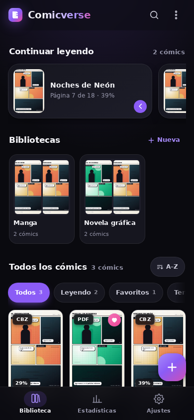 | 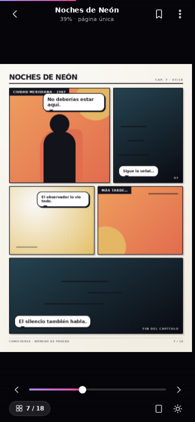 | 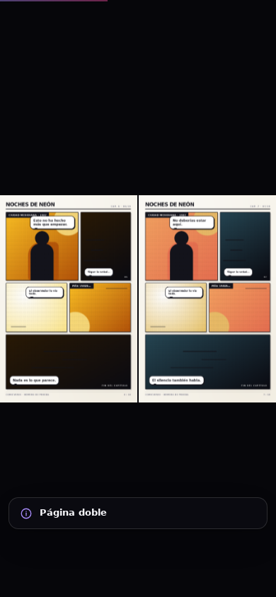 | 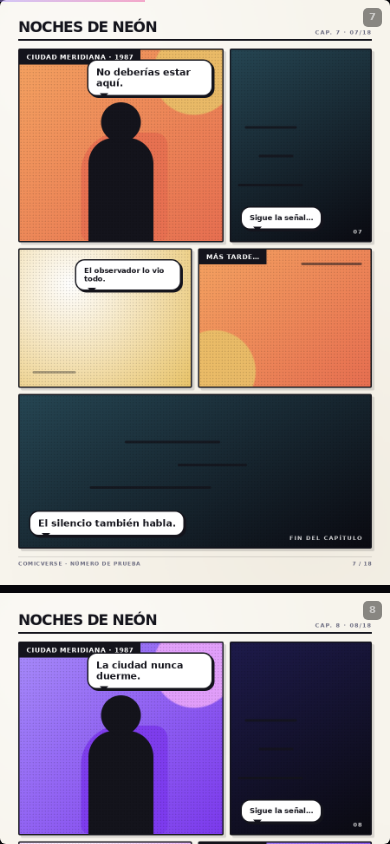 |

| Ficha del cómic | Ajustes de lectura | Miniaturas | Una biblioteca |
| --- | --- | --- | --- |
| 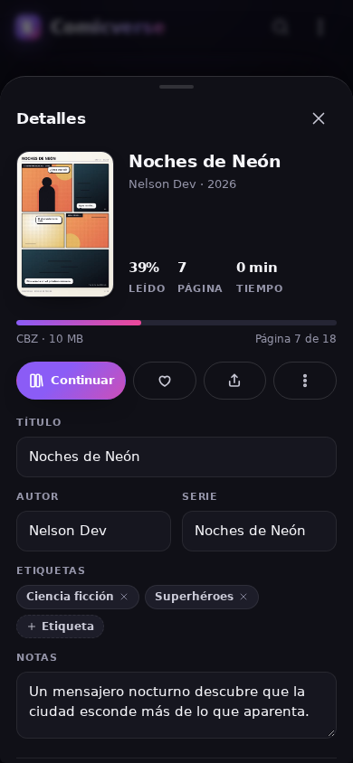 | 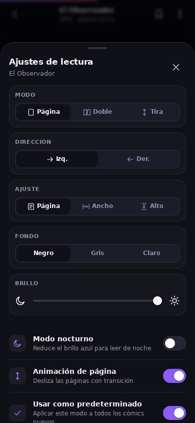 | 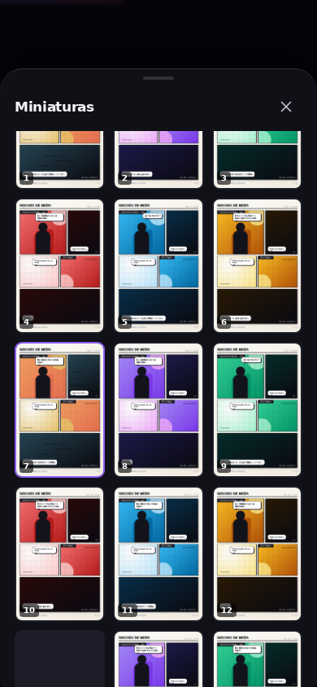 | 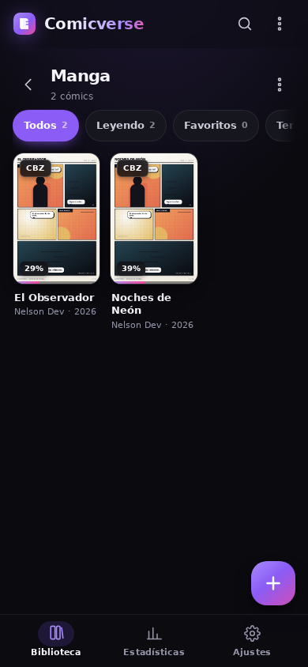 |

| PDF | Menú | Estadísticas | Escritorio |
| --- | --- | --- | --- |
| 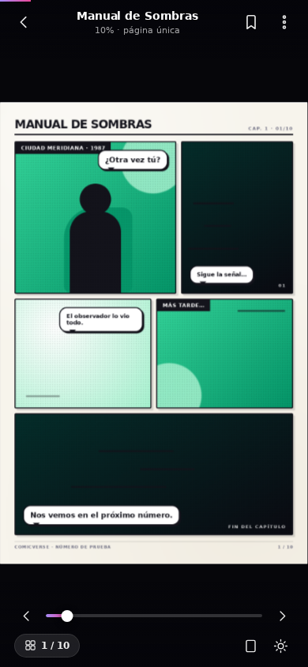 | 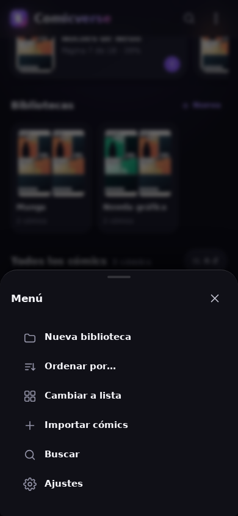 | 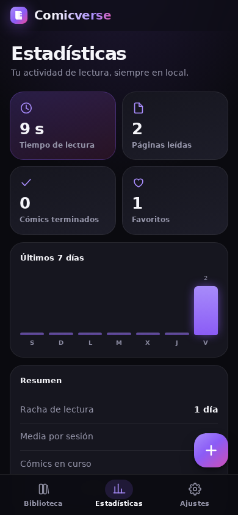 | 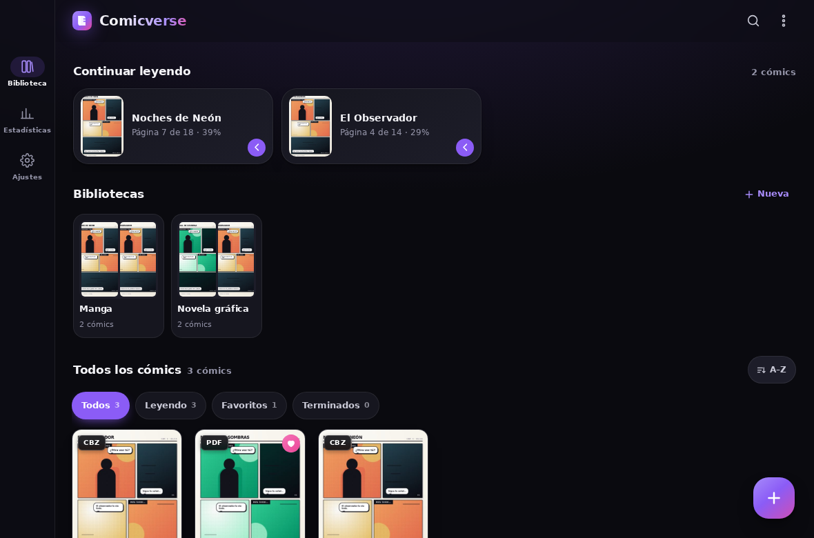 |

| Ajustes | Tema claro | Bienvenida | Importando |
| --- | --- | --- | --- |
| 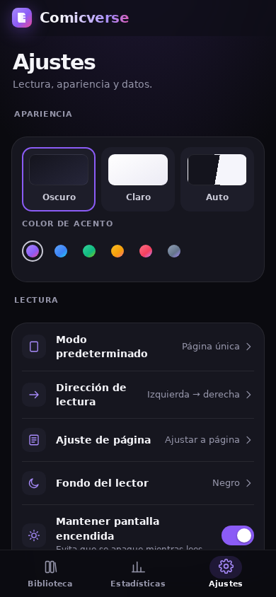 | 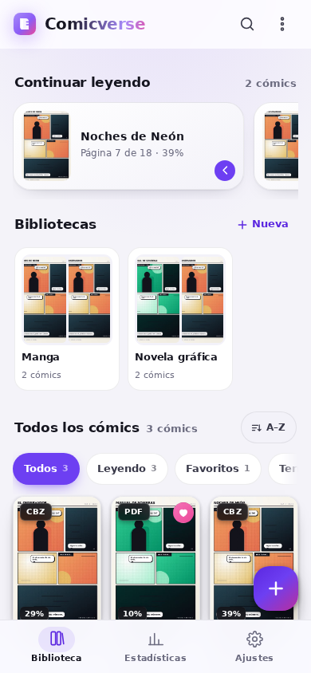 | 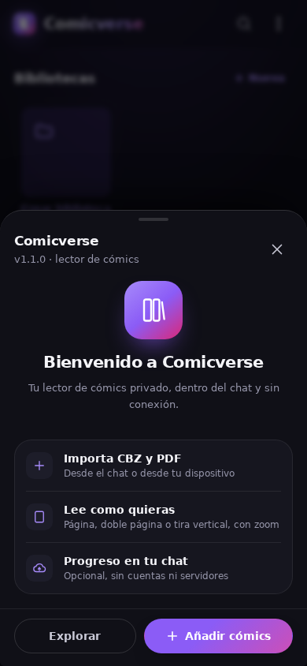 | 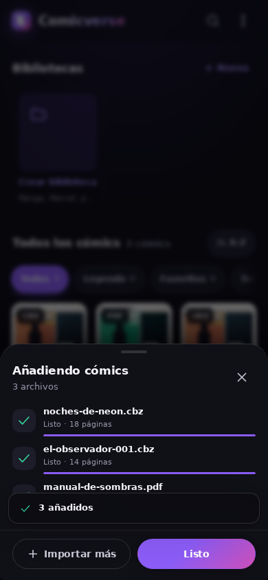 |

---

## Características

### Lectura
- **CBZ/ZIP** con **lector ZIP diferido**: solo se lee el índice del archivo y cada página se descomprime al
  pedirla, así que un tomo de 116 MB abre en ~6 ms en vez de varios segundos (con reserva automática a JSZip
  en navegadores antiguos) y **PDF** (pdf.js en worker, render a canvas nítido por DPI).
- Tres modos: **página única**, **página doble** (con reparto correcto de portada e impares) y **tira vertical** (webtoon).
- **Zoom con pellizco** (1×–6×) con paneo limitado a los bordes de la página, **doble toque** para zoom rápido y rueda/trackpad en escritorio.
- Ajuste **página / ancho / alto**, fondo **negro / gris / claro**, control de **brillo**, **modo nocturno**.
- Dirección de lectura **izquierda→derecha** o **derecha→izquierda** (manga).
- Transiciones de página tipo «carrusel» (desactivables), gestos de swipe, zonas de toque, atajos de teclado.
- **Miniaturas** para saltar a cualquier página, marcador de página, barra de progreso con *scrub*.
- Preferencias **por cómic** + valores predeterminados globales.

### Biblioteca
- Archivo **ordenado alfabéticamente por defecto** (natural, sin acentos y con los números primero);
  también por Z–A, autor, última lectura, fecha de alta, páginas o progreso, y separadores de letra en la vista de lista.
- Importación múltiple con cola de progreso, **detección de duplicados** por hash y extracción automática de portada.
- **Metadatos ComicInfo.xml**: título, serie, autor, editorial, año, géneros y sinopsis.
  Si el archivo declara un manga japonés, el lector arranca en **derecha→izquierda**.
- Búsqueda **sin acentos**, filtros (todos / leyendo / favoritos / terminados) y vistas **cuadrícula/lista**.
- Ficha de detalle: edición de título, autor, serie, etiquetas, notas, favoritos, bibliotecas y marcadores.
- **Continuar leyendo** en la portada, progreso visible en cada portada.
- **Bibliotecas** independientes, como listas de reproducción: carril en la portada, cabecera propia al abrirlas,
  contadores y filtros acotados a la lista, y añadir/quitar cómics desde la ficha o con el menú de la tarjeta.
- **Series y tomos**: la ficha lista los tomos de la serie ordenados por número y el lector salta al tomo
  anterior/siguiente desde su menú. Los CBZ que declaran manga japonés arrancan en derecha→izquierda.
- **Un solo menú** (⋮) en la barra superior: nueva biblioteca, orden, vista, importar, buscar y ajustes.

### Estadísticas y datos
- Tiempo de lectura, páginas leídas, racha de días y gráfico de los últimos 7 días.
- Copia de seguridad JSON (exportar/restaurar) y borrado completo de datos.
- Tema **oscuro / claro / automático**, seis acentos, diseño mobile-first con barra lateral en escritorio.

### Integración con el chat (webxdc)
- `webxdc.importFiles()` para importar CBZ/PDF directamente desde los adjuntos del chat.
- `webxdc.sendToChat()` para reenviar un cómic o la copia de seguridad.
- `sendUpdate()` / `setUpdateListener()` para **sincronizar el progreso de lectura** entre miembros del chat,
  con *throttling* respetando `sendUpdateInterval` y `sendUpdateMaxSize`, y agrupado (*batch*) de mensajes.
- Sin `webxdc.js` (navegador normal) usa `<input type=file>` y descarga de archivos, sin errores.

---

## Estructura

```
Comicverse/
├── index.html              # shell de la app (una sola página)
├── manifest.toml           # metadatos webxdc
├── icon.png                # icono 512×512
├── build.sh                # empaqueta release/comicverse-<version>.xdc
├── assets/
│   ├── css/app.css         # sistema de diseño completo (tokens, componentes, lector)
│   ├── js/
│   │   ├── util.js         # helpers, toasts, sheets/modales
│   │   ├── db.js           # IndexedDB (libros, archivos, marcadores, colecciones, stats)
│   │   ├── wx.js           # capa webxdc + fallbacks de navegador
│   │   ├── lazyzip.js      # lector ZIP diferido (índice + DecompressionStream)
│   │   ├── sources.js      # CBZ (diferido con reserva a JSZip) + PDF (pdf.js) + portadas
│   │   ├── library.js      # biblioteca, importación, metadatos, colecciones
│   │   ├── reader.js       # motor de lectura (paginado, doble, scroll, zoom, gestos)
│   │   ├── stats.js        # estadísticas
│   │   ├── settings.js     # ajustes, almacenamiento, backups
│   │   └── app.js          # arranque, navegación, estanterías, sync del chat
│   └── vendor/             # pdf.js 3.11 + JSZip 3.10 (locales, con sus licencias)
├── dev/                    # solo desarrollo: servidor local, simulador webxdc, icono, capturas
├── tests/                  # pruebas E2E con Chromium + generador de cómics de ejemplo
└── docs/                   # capturas del README y auditoría técnica (AUDITORIA.md)
```

`dev/` y `tests/` **nunca** se empaquetan en el `.xdc`, y `webxdc.js` tampoco: lo inyecta el mensajero.

---

## Desarrollo

```bash
python3 dev/serve.py 8080      # http://localhost:8080 (inyecta dev/webxdc.js como simulador)
```

El simulador de webxdc permite probar `importFiles`, `sendToChat` y las actualizaciones sin mensajero.

### Pruebas

```bash
node tests/make-fixtures.mjs   # genera 2 CBZ (con ComicInfo.xml) + 1 PDF de ejemplo
node tests/smoke.mjs           # 43 comprobaciones E2E + capturas en tests/shots
node tests/audit.mjs           # auditoría: red, fugas, memoria, a11y, sync, XSS, escala, ZIP diferido, bibliotecas, orden
node tests/xdc-test.mjs        # prueba el .xdc empaquetado como lo haría el mensajero
node dev/docs-shots.mjs        # regenera las capturas de docs/screenshots
```

Los resultados de la auditoría técnica (22 secciones, hallazgos y correcciones) están en
[`docs/AUDITORIA.md`](docs/AUDITORIA.md).

Todos los scripts usan Chromium headless mediante `puppeteer-core` (instalado aparte, fuera del repo).

---

## Empaquetar

```bash
./build.sh                     # → release/comicverse-1.1.0.xdc (~2,2 MB)
```

El `.xdc` es un ZIP con `index.html`, `manifest.toml`, `icon.png` y `assets/`. Comparte el archivo en
cualquier chat de Delta Chat y pulsa **Iniciar** para usarlo.

---

## Privacidad

Comicverse no tiene servidores, analíticas, cuentas ni permisos de red. Los cómics, las portadas, el progreso
y las estadísticas viven **solo** en el almacenamiento local del dispositivo (IndexedDB). Lo único que viaja
al chat es lo que el usuario decide enviar o el progreso de lectura (opcional y desactivable) mediante la API
del mensajero.

## Licencias de terceros

- **pdf.js** — Apache License 2.0 (`assets/vendor/pdfjs/LICENSE`)
- **JSZip** — MIT / GPLv3 (`assets/vendor/JSZIP-LICENSE.markdown`)
- Iconos e ilustraciones — SVG propios.

## Licencia

MIT.
